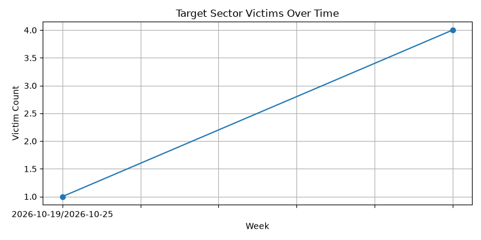
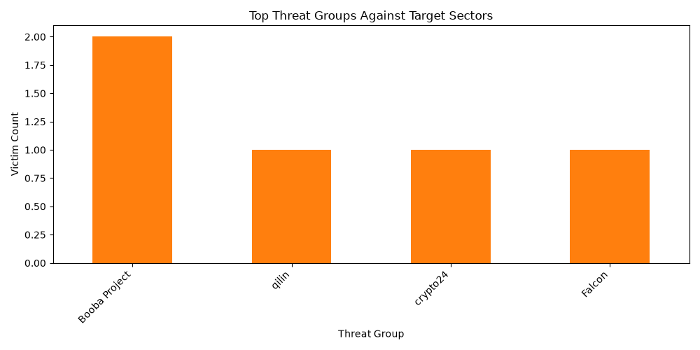

# Ransomware Leak-Site Tracker (Healthcare & Biotechnology Focus)

An automated Cyber Threat Intelligence (CTI) pipeline that scrapes public ransomware extortion data, normalizes records into a local SQLite database, and filters threat actor activity specifically across the healthcare, pharmaceuticals, and biotechnology sectors to assess organizational risk exposure and potential PHI compromise.

---

## 🚀 The Problem & Objective
Healthcare delivery organizations, pharmaceutical manufacturers, and biotech research firms face severe cyber threats due to the critical nature of their services and the high value of Protected Health Information (PHI) and proprietary clinical data. This project automates OSINT collection from public leak-site aggregators to track active ransomware campaigns targeting medical and life sciences supply chains.

---

## 🛠️ Architecture & Approach
1. **Data Collection (`collect.py`):** Pulls raw JSON payloads from public aggregator endpoints (`ransomware.live`), normalizes fields, and securely upserts records into a local SQLite database (`victims.db`).
2. **Sector Filtering (`filter.py` & `config.py`):** Applies specialized keyword arrays (`healthcare`, `hospital`, `pharma`, `biotech`, `clinical`, `diagnostics`, etc.) to isolate high-relevance medical supply chain threats.
3. **Automated Reporting (`report.py`):** Aggregates filtered data, computes weekly trends, generates Matplotlib visualizations, and compiles a structured executive Markdown summary (`weekly_report.md`).
4. **Cloud Automation (`.github/workflows/collect.yml`):** Uses GitHub Actions on a daily cron schedule to fetch fresh intel and automatically commit updated database states back to the repository.

---

## 📊 Sample Output & Visualizations

### Healthcare Sector Victims Over Time (Weekly Trend)


### Top Threat Groups Targeting Healthcare & Biotech


---

## ⚙️ How to Run Locally

1. **Clone the repository:**
   ```bash
   git clone [https://github.com/ds-cybersec/ransomware-leak-tracker-Healthcare.git](https://github.com/ds-cybersec/ransomware-leak-tracker-Healthcare.git)